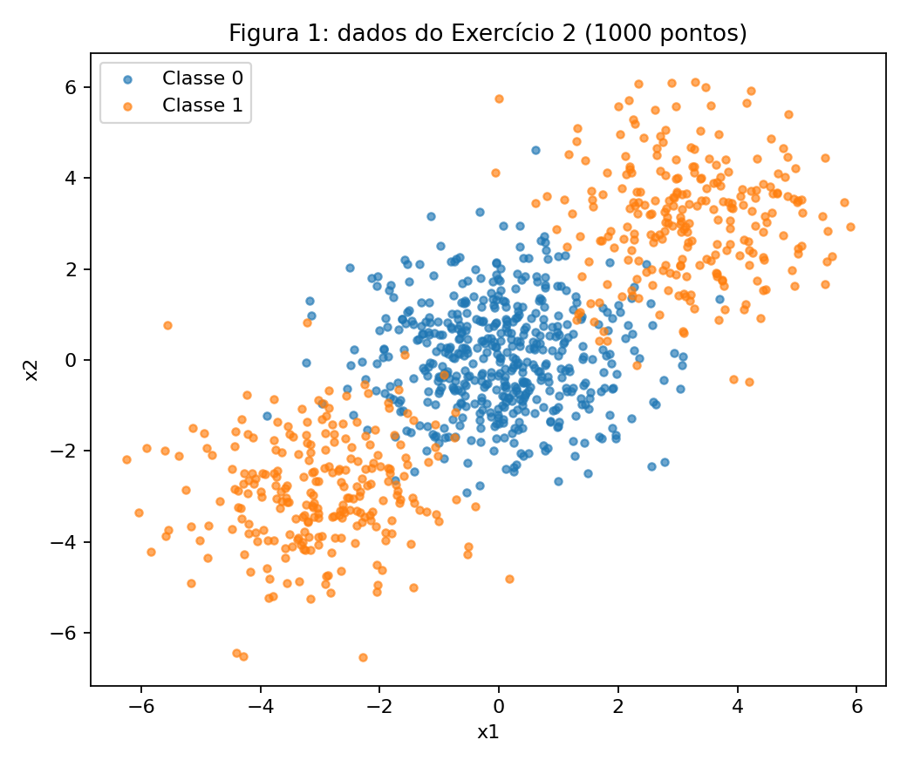
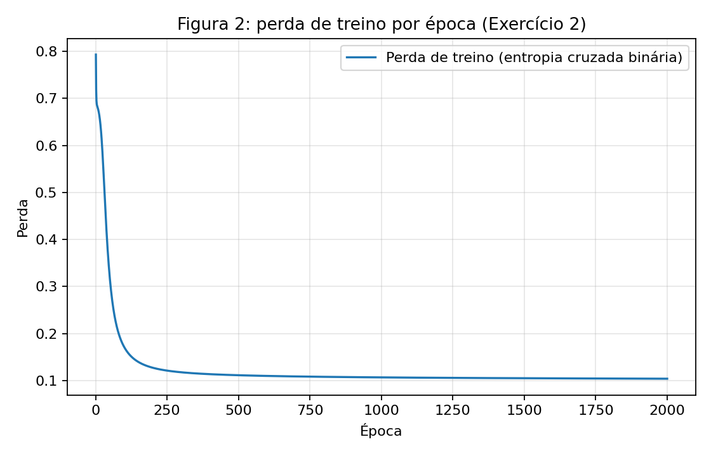
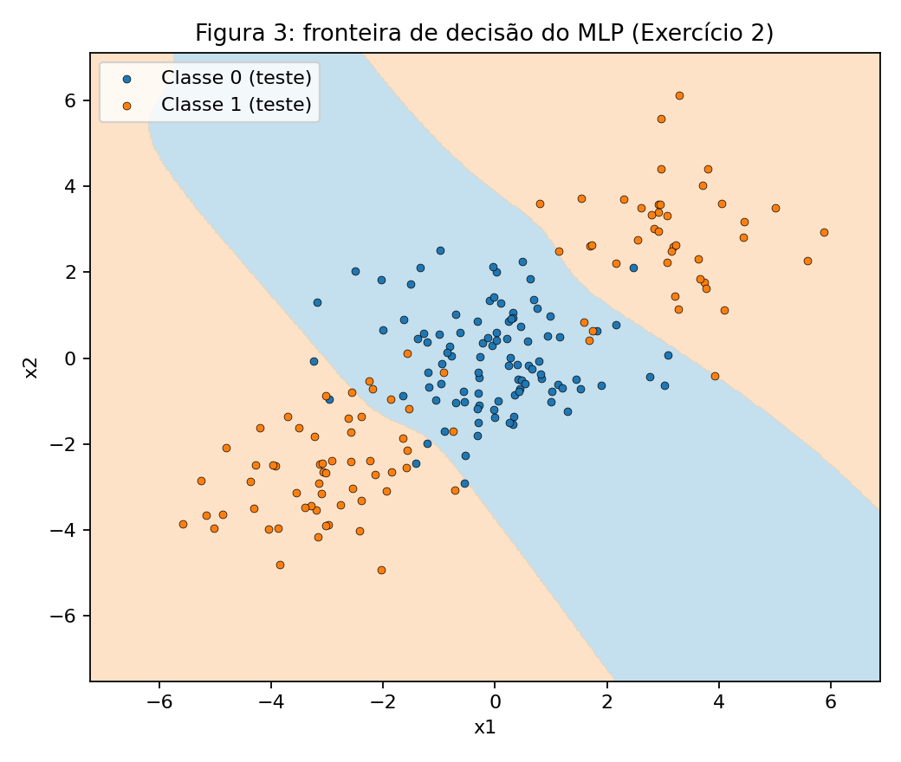
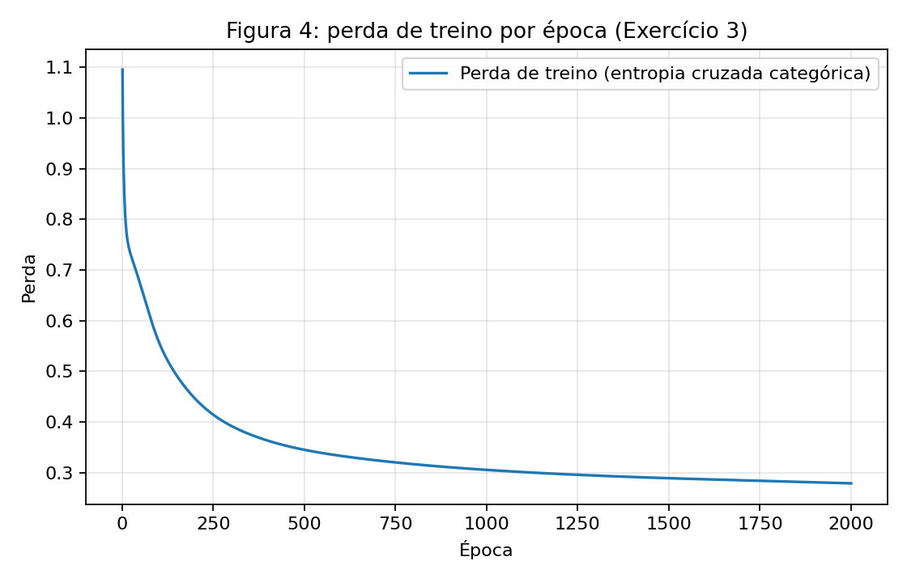
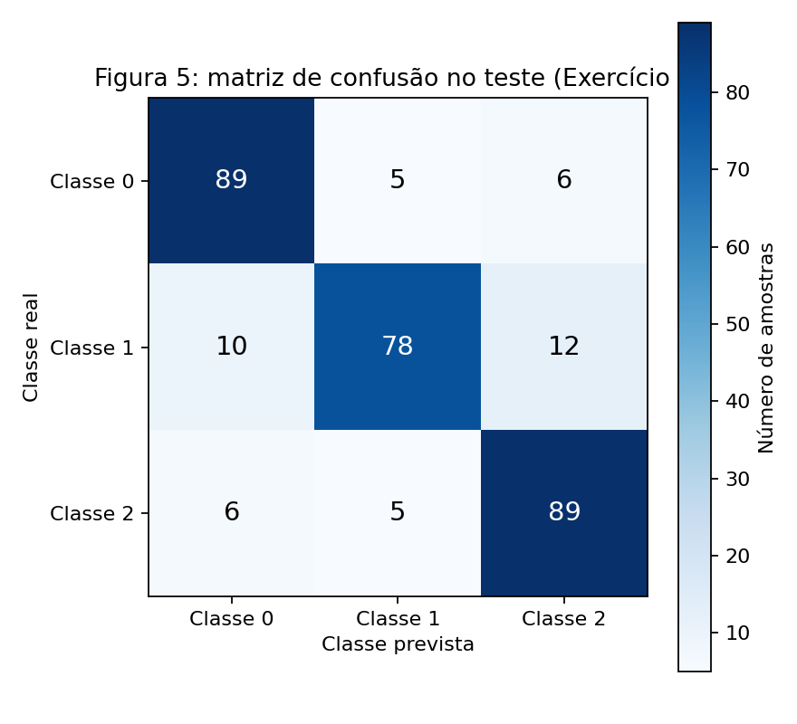
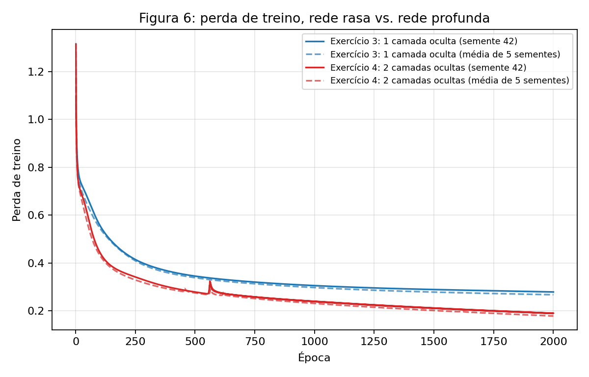

# 3. MLP

Neste relatório foi implementado do zero um Perceptron de Múltiplas Camadas (MLP), com passagem direta, perda, passagem reversa e atualização escritas em NumPy, sem nenhuma biblioteca de redes neurais. O Exercício 1 resolve na mão um passo de retropropagação. O Exercício 2 aplica o MLP a um problema binário que nenhuma reta resolve, o Exercício 3 estende a mesma rede a três classes e o Exercício 4 pergunta se uma segunda camada oculta ajuda. O `scikit-learn` foi usado apenas para gerar e dividir os dados, para a linha de base logística e para a matriz de confusão. Os experimentos usam `np.random.default_rng(42)` e `random_state=42`, e o código de cada exercício está em um arquivo próprio em `code/`.

## Exercício 1

### Um passo de retropropagação, na mão

A rede tem 2 entradas, 1 camada oculta de 2 neurônios e 1 saída, com $\tanh$ nas duas camadas e perda $L=(y-\hat y)^2$ para uma única amostra. Os valores são $\mathbf{x}=[0{,}5,\ -0{,}2]$, $y=1{,}0$, $\eta=0{,}3$ e

$$
\mathbf{W}^{(1)}=\begin{bmatrix}0{,}3 & -0{,}1\\ 0{,}2 & 0{,}4\end{bmatrix},\quad
\mathbf{b}^{(1)}=[0{,}1,\ -0{,}2],\quad
\mathbf{W}^{(2)}=[0{,}5,\ -0{,}3],\quad
b^{(2)}=0{,}2 .
$$

### A — Passagem direta

**1. Pré-ativações da camada oculta**, $\mathbf{z}^{(1)}=\mathbf{W}^{(1)}\mathbf{x}+\mathbf{b}^{(1)}$:

$$
z^{(1)}_1 = 0{,}3\cdot 0{,}5 + (-0{,}1)(-0{,}2) + 0{,}1 = 0{,}1500+0{,}0200+0{,}1000 = 0{,}270000
$$

$$
z^{(1)}_2 = 0{,}2\cdot 0{,}5 + 0{,}4\,(-0{,}2) - 0{,}2 = 0{,}1000-0{,}0800-0{,}2000 = -0{,}180000
$$

**2. Ativações da camada oculta**, $\mathbf{h}^{(1)}=\tanh(\mathbf{z}^{(1)})$:

$$
h^{(1)}_1=\tanh(0{,}27)=0{,}263625,\qquad h^{(1)}_2=\tanh(-0{,}18)=-0{,}178081
$$

**3. Pré-ativação de saída**, $u^{(2)}=\mathbf{W}^{(2)}\mathbf{h}^{(1)}+b^{(2)}$:

$$
u^{(2)}=0{,}5\cdot 0{,}263625+(-0{,}3)(-0{,}178081)+0{,}2=0{,}131813+0{,}053424+0{,}2=0{,}385237
$$

**4. Saída e perda:**

$$
\hat y=\tanh(0{,}385237)=0{,}367247,\qquad L=(1-0{,}367247)^2=0{,}632753^2=0{,}400377
$$

### B — Passagem reversa

Usa-se $\dfrac{d}{du}\tanh(u)=1-\tanh^2(u)$, que vale $1-\hat y^2$ na saída e $1-(h^{(1)}_i)^2$ na camada oculta.

**1. Gradiente em relação à saída e à pré-ativação de saída.** Como $L=(y-\hat y)^2$,

$$
\frac{\partial L}{\partial \hat y}=-2\,(y-\hat y)=-2\cdot 0{,}632753=-1{,}265507
$$

$$
\frac{\partial L}{\partial u^{(2)}}=\frac{\partial L}{\partial \hat y}\,(1-\hat y^2)=-1{,}265507\cdot(1-0{,}367247^2)=-1{,}265507\cdot 0{,}865130=-1{,}094828
$$

**2. Camada de saída.** Como $u^{(2)}=\mathbf{W}^{(2)}\mathbf{h}^{(1)}+b^{(2)}$, tem-se $\partial u^{(2)}/\partial W^{(2)}_i=h^{(1)}_i$ e $\partial u^{(2)}/\partial b^{(2)}=1$:

$$
\frac{\partial L}{\partial \mathbf{W}^{(2)}}=\frac{\partial L}{\partial u^{(2)}}\,\mathbf{h}^{(1)}=[-1{,}094828\cdot 0{,}263625,\ -1{,}094828\cdot(-0{,}178081)]=[-0{,}288624,\ +0{,}194968]
$$

$$
\frac{\partial L}{\partial b^{(2)}}=-1{,}094828
$$

**3. Propagação para a camada oculta.** Como $\partial u^{(2)}/\partial h^{(1)}_i=W^{(2)}_i$,

$$
\frac{\partial L}{\partial \mathbf{h}^{(1)}}=\frac{\partial L}{\partial u^{(2)}}\,\mathbf{W}^{(2)}=[-1{,}094828\cdot 0{,}5,\ -1{,}094828\cdot(-0{,}3)]=[-0{,}547414,\ +0{,}328448]
$$

Com $1-(h^{(1)}_1)^2=0{,}930502$ e $1-(h^{(1)}_2)^2=0{,}968287$,

$$
\frac{\partial L}{\partial \mathbf{z}^{(1)}}=\frac{\partial L}{\partial \mathbf{h}^{(1)}}\odot(1-\mathbf{h}^{(1)2})=[-0{,}547414\cdot 0{,}930502,\ 0{,}328448\cdot 0{,}968287]=[-0{,}509370,\ +0{,}318032]
$$

**4. Camada oculta.** Como $z^{(1)}_i=\sum_j W^{(1)}_{ij}x_j+b^{(1)}_i$, tem-se $\partial L/\partial W^{(1)}_{ij}=(\partial L/\partial z^{(1)}_i)\,x_j$:

$$
\frac{\partial L}{\partial \mathbf{W}^{(1)}}=\frac{\partial L}{\partial \mathbf{z}^{(1)}}\,\mathbf{x}^{\top}=
\begin{bmatrix}-0{,}509370\cdot 0{,}5 & -0{,}509370\cdot(-0{,}2)\\ 0{,}318032\cdot 0{,}5 & 0{,}318032\cdot(-0{,}2)\end{bmatrix}=
\begin{bmatrix}-0{,}254685 & +0{,}101874\\ +0{,}159016 & -0{,}063606\end{bmatrix}
$$

$$
\frac{\partial L}{\partial \mathbf{b}^{(1)}}=\frac{\partial L}{\partial \mathbf{z}^{(1)}}=[-0{,}509370,\ +0{,}318032]
$$

### C — Atualização dos parâmetros

Com $\eta=0{,}3$, aplica-se $\theta\leftarrow\theta-\eta\,\partial L/\partial\theta$ aos oito parâmetros:

| Parâmetro | Antes | Gradiente | Depois |
|---|---:|---:|---:|
| $W^{(2)}_1$ | 0,5000 | $-0{,}288624$ | **0,586587** |
| $W^{(2)}_2$ | $-0{,}3000$ | $+0{,}194968$ | **$-0{,}358490$** |
| $b^{(2)}$ | 0,2000 | $-1{,}094828$ | **0,528448** |
| $W^{(1)}_{11}$ | 0,3000 | $-0{,}254685$ | **0,376405** |
| $W^{(1)}_{12}$ | $-0{,}1000$ | $+0{,}101874$ | **$-0{,}130562$** |
| $W^{(1)}_{21}$ | 0,2000 | $+0{,}159016$ | **0,152295** |
| $W^{(1)}_{22}$ | 0,4000 | $-0{,}063606$ | **0,419082** |
| $b^{(1)}_1$ | 0,1000 | $-0{,}509370$ | **0,252811** |
| $b^{(1)}_2$ | $-0{,}2000$ | $+0{,}318032$ | **$-0{,}295410$** |

A tabela lista nove números porque $\mathbf{W}^{(1)}$ e $\mathbf{b}^{(1)}$ têm 4 e 2 entradas, $\mathbf{W}^{(2)}$ tem 2 e $b^{(2)}$ tem 1, totalizando 9 parâmetros escalares na rede.

**A perda desce numa segunda passagem direta.** O gradiente descendente move cada parâmetro no sentido oposto ao de seu gradiente, e para um passo pequeno a variação da perda é $\Delta L\approx-\eta\lVert\nabla L\rVert^2$. Aqui $\lVert\nabla L\rVert^2=1{,}7851$, de modo que a aproximação de primeira ordem prevê uma queda de $0{,}5355$. A segunda passagem direta com os parâmetros atualizados confirma a queda: $\hat y$ passa de $0{,}367247$ para $0{,}711181$, mais perto do alvo $y=1$, e a perda cai de $0{,}400377$ para $0{,}083417$, uma variação de $-0{,}316960$. A queda real é menor que a prevista porque $\eta=0{,}3$ não é um passo infinitesimal e a $\tanh$ é curva.

Os gradientes foram conferidos por diferenças finitas centrais, com erro máximo de $7{,}9\times10^{-11}$. O script abaixo reproduz todos os números desta seção usando apenas a biblioteca padrão do Python.

``` { .python .copy .select linenums="1" title="docs/exercises/mlp/code/exercise1.py" }
--8<-- "docs/exercises/mlp/code/exercise1.py"
```

## Exercício 2

### Classificação binária que uma reta não resolve

### A — Gere os dados

Os dados foram gerados com `make_blobs`, com os parâmetros do enunciado: centros $[0,0]$, $[3,3]$ e $[-3,-3]$, com 500, 250 e 250 amostras e `cluster_std=1.2`. A classe 0 é o grupo central e a classe 1 reúne os dois grupos laterais. A divisão foi de 80% para treino (800 pontos) e 20% para teste (200 pontos), estratificada, com `random_state=42`. O conjunto de teste tem 100 pontos de cada classe.


/// caption
**Figura 1** — Dispersão dos 1000 pontos, coloridos por classe. A classe 1 aparece em dois grupos, em lados opostos da classe 0.
///

### B — Estabeleça a linha de base

Uma regressão logística ajustada ao conjunto de treino obteve **47,50%** de acurácia no teste, abaixo dos 50% de um palpite. Os coeficientes aprendidos são praticamente nulos, $w=[0{,}0296,\ 0{,}0015]$ e $b=-0{,}0031$, e o modelo prevê a classe 1 para 44,5% dos pontos de teste.

### C — Implemente o MLP

O MLP é a classe `MLP` do arquivo `exercise2.py`, que recebe a lista de tamanhos das camadas como argumento. As camadas ocultas usam $\tanh$, a saída usa a sigmoide e a perda é a entropia cruzada binária. A passagem direta, a reversa e a atualização foram implementadas à mão, sem autodiff. Na passagem reversa, a saída tem

$$
\frac{\partial L}{\partial \mathbf{u}^{(L)}}=\frac{\mathbf{P}-\mathbf{Y}}{N},
\qquad
\frac{\partial L}{\partial \mathbf{W}^{(l)}}=\mathbf{A}^{(l-1)\top}\boldsymbol{\delta}^{(l)},
\qquad
\boldsymbol{\delta}^{(l-1)}=\left(\boldsymbol{\delta}^{(l)}\mathbf{W}^{(l)\top}\right)\odot\left(1-\mathbf{A}^{(l-1)\,2}\right),
$$

e a atualização é $\mathbf{W}^{(l)}\leftarrow\mathbf{W}^{(l)}-\eta\,\partial L/\partial\mathbf{W}^{(l)}$, com o mesmo formato para os biases. Os pesos têm inicialização de Xavier, com $\mathcal{N}(0,1/n_{\text{entrada}})$ sorteada por `np.random.default_rng(42)`, e o treino é por gradiente descendente em lote completo.

``` { .python .copy .select linenums="1" title="docs/exercises/mlp/code/exercise2.py" }
--8<-- "docs/exercises/mlp/code/exercise2.py"
```

| Item | Valor |
|---|---|
| Arquitetura | $[2,\ 8,\ 1]$ (uma camada oculta de 8 neurônios $\tanh$, saída sigmoide) |
| Parâmetros | 33 |
| Taxa de aprendizado | 0,5 |
| Épocas | 2.000 |
| Perda final de treino | 0,1043 |
| Acurácia de treino | 96,75% |
| **Acurácia de teste** | **91,50%** |


/// caption
**Figura 2** — Perda de treino (entropia cruzada binária) por época. Ela cai de 0,7930 na época 1 para 0,1716 na época 100 e 0,1043 na época 2.000.
///


/// caption
**Figura 3** — Fronteira de decisão do MLP sobre os pontos de teste. A região azul é atribuída à classe 0 e a região laranja à classe 1.
///

### D — Análise

**Por que a linha de base fica abaixo de 50%.** Os dois grupos da classe 1 estão em $(3,3)$ e $(-3,-3)$, de modo que seu centro de massa cai perto da origem, que é onde está a classe 0. No treino, a média da classe 0 é $(0{,}017;\ 0{,}055)$ e a da classe 1 é $(0{,}206;\ 0{,}205)$, praticamente o mesmo ponto. Uma reta separa as classes projetando os pontos em uma direção e comparando com um único limiar, mas nenhuma direção diferencia as duas classes pela posição média, e por isso os coeficientes da regressão logística ficaram próximos de zero e o modelo se comporta como um palpite. A acurácia de 47,50% não é um efeito sistemático de "ser pior que o acaso": com 200 pontos de teste o desvio padrão de uma acurácia ao acaso é cerca de 3,5 pontos percentuais, e 47,50% está a apenas 0,7 desvio de 50%.

**A geometria da Figura 3.** A região que a rede atribui à classe 0 é uma faixa diagonal, limitada por duas fronteiras inclinadas e quase paralelas que atravessam o gráfico de cima a baixo, e que contém o grupo central. A região da classe 1 tem duas partes desconectadas, uma no canto superior direito e outra no inferior esquerdo, ocupando os dois lados da faixa. Projetando os pontos de treino na direção $(1,1)/\sqrt2$, a classe 1 fica longe da origem nos dois sentidos (distância média de 4,37, com mínimo de 1,33), enquanto a classe 0 fica concentrada em torno dela (distância máxima de 3,71). Portanto, a classe 1 corresponde à condição "projeção menor que $-t$ **ou** maior que $+t$". Uma reta produz um único limiar e só consegue dizer "maior que $t$" ou "menor que $t$", nunca as duas coisas. Já a camada oculta permite combinar várias retas: cada neurônio $\tanh$ traça uma fronteira própria e a camada de saída combina essas fronteiras, e duas delas já bastam para delimitar a faixa. Com isso o MLP representa a região de duas partes e chega a 91,50% de acurácia, dentro da faixa de 90% a 93% esperada para uma implementação correta.

## Exercício 3

### Multiclasse, a mesma rede

### A — Gere os dados

Os dados foram gerados com `make_classification`, com os parâmetros do enunciado: 1.500 amostras, 4 features informativas, 3 classes e 2 grupos por classe (6 grupos no total), `class_sep=1.0` e `random_state=42`. A divisão foi de 80% para treino (1.200 pontos) e 20% para teste (300 pontos, 100 por classe), estratificada, com `random_state=42`. As features foram padronizadas com a média e o desvio padrão do conjunto de treino, para não vazar informação do teste.

### B — Adapte a rede

A classe `MLP` é a mesma do Exercício 2 e é importada literalmente de `exercise2.py` (`from exercise2 import MLP`), sem copiar nem alterar a passagem direta, a reversa e a atualização. Mudam apenas argumentos: a saída passa a ter 3 unidades, a ativação de saída passa a ser a softmax e a perda passa a ser a entropia cruzada categórica.

**Derivação de $\partial L/\partial u$ para softmax e entropia cruzada.** Para uma amostra, com $p_k=\dfrac{e^{u_k}}{\sum_m e^{u_m}}$ e rótulo one-hot $\mathbf{y}$,

$$
L=-\sum_k y_k\log p_k .
$$

A derivada da softmax é

$$
\frac{\partial p_k}{\partial u_j}=p_k\,(\delta_{kj}-p_j),
$$

em que $\delta_{kj}$ vale 1 se $k=j$ e 0 caso contrário. Pela regra da cadeia,

$$
\frac{\partial L}{\partial u_j}
=-\sum_k \frac{y_k}{p_k}\,\frac{\partial p_k}{\partial u_j}
=-\sum_k y_k\,(\delta_{kj}-p_j)
=-y_j+p_j\sum_k y_k
=p_j-y_j ,
$$

pois $\sum_k y_k=1$. Com a média sobre $N$ amostras, $\partial L/\partial \mathbf{U}=(\mathbf{P}-\mathbf{Y})/N$. O resultado é a diferença entre a probabilidade prevista e o rótulo, e é o mesmo que se obtém no caso binário (sigmoide com entropia cruzada binária). Por isso a passagem reversa do Exercício 2 funciona sem nenhuma alteração.

``` { .python .copy .select linenums="1" title="docs/exercises/mlp/code/exercise3.py" }
--8<-- "docs/exercises/mlp/code/exercise3.py"
```

### C — Treine e avalie

| Item | Valor |
|---|---|
| Arquitetura | $[4,\ 16,\ 3]$ (uma camada oculta de 16 neurônios $\tanh$, saída softmax) |
| Parâmetros | 131 |
| Taxa de aprendizado | 0,5 |
| Épocas | 2.000 |
| Perda final de treino | 0,2786 |
| Acurácia de treino | 89,75% |
| **Acurácia de teste** | **85,33%** |


/// caption
**Figura 4** — Perda de treino (entropia cruzada categórica) por época para o MLP multiclasse.
///


/// caption
**Figura 5** — Matriz de confusão no conjunto de teste (300 amostras, 100 por classe).
///

### D — Análise

**Par mais confundido.** A Figura 5 mostra que o par de classes 1 e 2 é o mais confundido, com 17 erros: 12 amostras da classe 1 previstas como classe 2 e 5 da classe 2 previstas como classe 1. Em seguida vêm os pares 0 e 1 (15 erros) e 0 e 2 (12 erros). A classe 1 tem a pior revocação (78%), contra 89% das classes 0 e 2. A diferença entre os pares é pequena, de apenas 2 a 5 erros em 300 amostras, de modo que a confusão está espalhada por todos os pares e não concentrada em um só.

**Explicação pela estrutura dos dados.** São 6 grupos em 4 dimensões, dois por classe, com `class_sep=1,0`. Segundo a documentação do `scikit-learn`, o `make_classification` coloca os centros dos grupos nos vértices de um hipercubo de lado $2\cdot$`class_sep`, e então aplica a cada grupo uma covariância aleatória. Com esse espaçamento, o tamanho típico de cada grupo é comparável à distância entre grupos vizinhos, e como os dois grupos de uma classe ficam separados um do outro, cada classe tende a ter vizinhos de outras classes por mais de um lado. Isso favorece a sobreposição entre os grupos de classes diferentes em vários pontos do espaço, e não apenas entre um par de classes, o que é coerente com os erros espalhados entre os três pares. Uma parte dos erros restantes é, portanto, ruído inerente à sobreposição dos grupos, e nenhum classificador acertaria todos esses pontos.

**Linha de base e o que a camada oculta acrescentou.** A regressão logística, que usa uma única fronteira linear por classe, obteve **66,33%** no teste. O MLP com uma camada oculta obteve 85,33%, um ganho de 19,0 pontos percentuais. Como cada classe é a união de dois grupos separados, o problema é do mesmo tipo do Exercício 2: um modelo linear não consegue desenhar, para uma mesma classe, duas regiões distintas, e a camada oculta fornece essa flexibilidade ao combinar várias fronteiras.

## Exercício 4

### Uma segunda camada oculta ajuda?

### A — Treine a rede mais profunda

A comparação é controlada: mesmos dados, mesma divisão, mesma padronização, 2.000 épocas, taxa de aprendizado 0,5 e a mesma função de treino do Exercício 3. A única mudança é a profundidade, de $[4,16,3]$ para $[4,16,16,3]$ (duas camadas ocultas de 16 neurônios). Para comparar modelos e não a sorte, cada rede foi treinada com 5 sementes de inicialização de pesos (42 a 46); os dados e a divisão são fixos, e a semente 42 é a mesma usada no Exercício 3.

``` { .python .copy .select linenums="1" title="docs/exercises/mlp/code/exercise4.py" }
--8<-- "docs/exercises/mlp/code/exercise4.py"
```

A rede profunda tem 403 parâmetros e, com a semente 42, obteve 83,33% no teste, contra 85,33% da rasa.

### B — Compare

| | Camadas ocultas | Parâmetros | Perda final de treino | Acurácia no teste |
|---|---:|---:|---:|---:|
| Exercício 3 | 1 | 131 | 0,2671 (± 0,0082) | 84,53% (± 1,13) |
| Exercício 4 | 2 | 403 | 0,1783 (± 0,0097) | 84,40% (± 1,87) |

Os valores são médias de 5 sementes, com o desvio padrão entre parênteses. A diferença de acurácia (profunda menos rasa) é de **$-0{,}13$ ponto percentual**.

| Semente | Acurácia (rasa) | Acurácia (profunda) |
|---:|---:|---:|
| 42 | 85,33% | 83,33% |
| 43 | 83,33% | 81,33% |
| 44 | 85,67% | 85,33% |
| 45 | 85,33% | 85,33% |
| 46 | 83,00% | 86,67% |


/// caption
**Figura 6** — Curvas de perda de treino das redes do Exercício 3 (azul) e do Exercício 4 (vermelho). As linhas contínuas são a semente 42 e as tracejadas, a média das 5 sementes.
///

### C — Análise

**O que foi medido.** A rede mais profunda não superou a mais rasa: a acurácia média no teste foi de 84,40% contra 84,53%, uma diferença de $-0{,}13$ ponto percentual, muito menor que o desvio padrão entre sementes (1,13 e 1,87 pontos). As duas redes são, portanto, estatisticamente indistinguíveis neste experimento, e a profundidade não trouxe benefício. A ordem entre elas até se inverte de uma semente para outra (a profunda perde nas sementes 42, 43 e 44 e ganha na 46).

**A perda de treino conta outra história.** A rede profunda alcança uma perda de treino média de 0,1783, cerca de 33% menor que a 0,2671 da rasa, e a Figura 6 mostra a perda da rede profunda abaixo da rasa em quase todo o treino (0,4338 contra 0,5475 na época 100 e 0,2748 contra 0,3384 na época 500, em média). A perda de treino menor indica que a rede mais profunda se ajusta melhor aos dados de treino, mas esse ajuste melhor não se converteu em acurácia no teste. Esse quadro é compatível com a segunda camada usando sua capacidade extra para acomodar o ruído de treino e não para capturar estrutura que generalize. A curva da semente 42 da rede profunda também tem um pico em torno da época 560, que sinaliza um treino menos estável com $\eta=0{,}5$.

**Por que a profundidade não compensa aqui.** Os dados têm apenas 6 grupos em 4 dimensões, e uma única camada oculta de 16 neurônios $\tanh$ já tem flexibilidade suficiente para desenhar uma fronteira que os separe, como mostra o ganho de 19 pontos sobre a linha de base linear. O que sobra de erro vem principalmente da sobreposição dos grupos (`class_sep=1,0`), que é uma limitação dos dados e não da capacidade da rede, de modo que acrescentar representação não a elimina. Em contrapartida, a segunda camada tem custos: triplica o número de parâmetros (de 131 para 403) e torna a otimização mais difícil, pois o gradiente precisa atravessar mais uma camada. O benefício que a representação extra traria não existe aqui, e o custo permanece.

**Que dados recompensariam a profundidade.** A profundidade compensa quando o problema tem estrutura hierárquica ou composicional, em que características simples se combinam em outras mais abstratas, como bordas que formam texturas e depois objetos em imagens, ou fonemas, palavras e frases em áudio e texto. Isso costuma vir com muitas features de entrada (centenas ou milhares, e não 4) e com muitas amostras, de modo que a rede possa aprender representações em vários níveis. Em dados tabulares pequenos e de baixa dimensão como estes, uma camada oculta costuma bastar.

## Resumo dos resultados

| # | Quantidade | Valor |
|---:|---|---|
| 1 | Ex. 1 — $\mathbf{z}^{(1)}$ e $\mathbf{h}^{(1)}$ | $\mathbf{z}^{(1)}=[0{,}270000,\ -0{,}180000]$; $\mathbf{h}^{(1)}=[0{,}263625,\ -0{,}178081]$ |
| 2 | Ex. 1 — $u^{(2)}$, $\hat{y}$ e $L$ | $u^{(2)}=0{,}385237$; $\hat y=0{,}367247$; $L=0{,}400377$ |
| 3 | Ex. 1 — os oito parâmetros atualizados | $\mathbf{W}^{(2)}=[0{,}586587,\ -0{,}358490]$; $b^{(2)}=0{,}528448$; $\mathbf{W}^{(1)}=\begin{bmatrix}0{,}376405 & -0{,}130562\\ 0{,}152295 & 0{,}419082\end{bmatrix}$; $\mathbf{b}^{(1)}=[0{,}252811,\ -0{,}295410]$ |
| 4 | Ex. 2 — acurácia da linha de base linear | 47,50% |
| 5 | Ex. 2 — arquitetura e acurácia no teste | $[2,8,1]$; 91,50% |
| 6 | Ex. 3 — arquitetura e acurácia no teste | $[4,16,3]$; 85,33% |
| 7 | Ex. 3 — par de classes mais confundido | Classes 1 e 2 (17 erros) |
| 8 | Ex. 4 — arquitetura e acurácia no teste | $[4,16,16,3]$; 83,33% (semente 42); 84,40% (média de 5 sementes) |
| 9 | Ex. 4 — diferença de acurácia em relação ao Ex. 3 (média de ≥ 3 sementes) | $-0{,}13$ ponto percentual (84,40% contra 84,53%, média de 5 sementes) |
