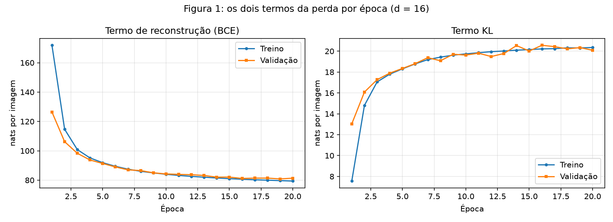
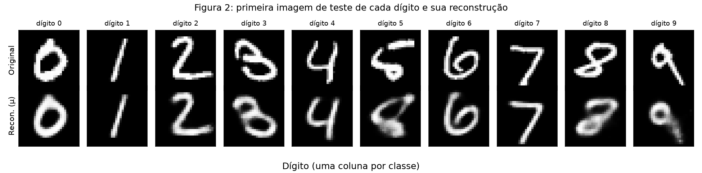
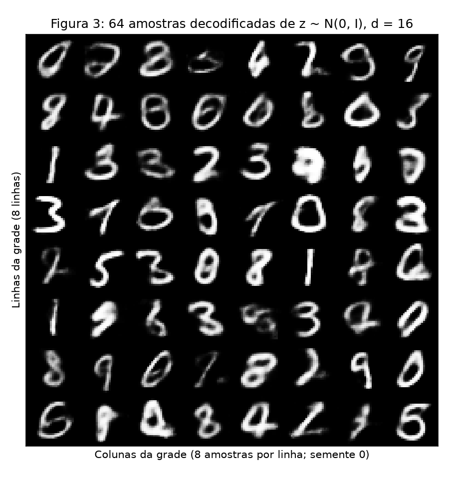
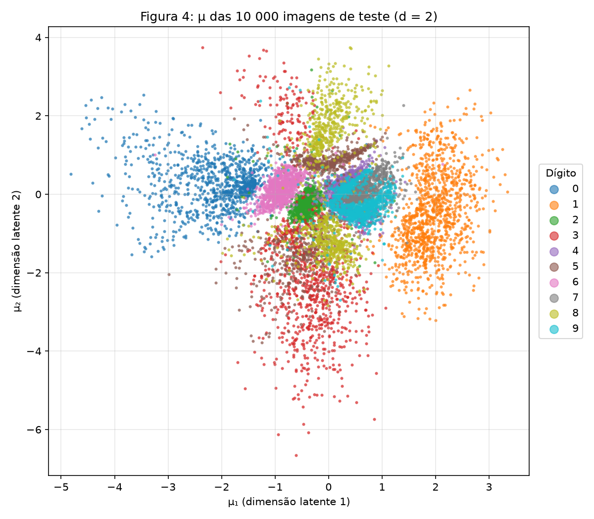
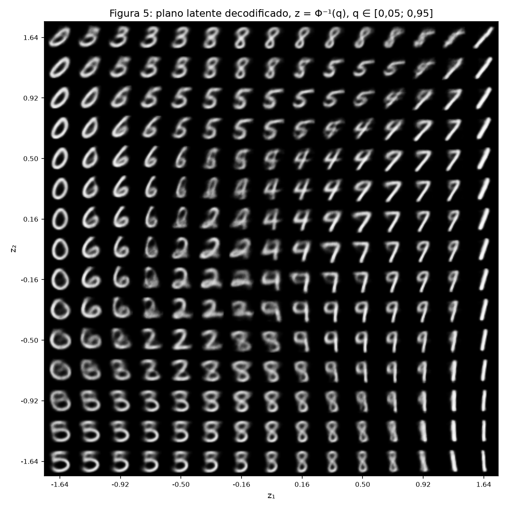
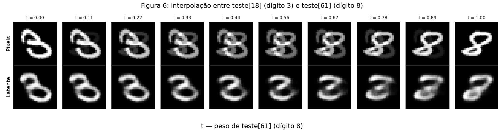

# 4. VAE

Este relatório apresenta um Autoencoder Variacional (VAE) no MNIST e analisa o compromisso entre reconstruir a entrada e regularizar o espaço latente em direção ao prior $p(z)=\mathcal{N}(0,I)$. O Exercício 1 usa dimensão latente $d=16$ e acompanha separadamente reconstrução e KL. O Exercício 2 reduz essa dimensão para $d=2$, visualiza o espaço aprendido e mede o custo da redução.

O [enunciado e a rubrica estão no site da disciplina](https://insper.github.io/ann-dl/) em **Exercises → 4. VAE**. A organização abaixo segue os itens A–E de cada exercício. Todas as perdas são apresentadas em **nats por imagem**, com soma sobre os pixels ou dimensões latentes e média sobre as imagens.

**Reprodução.** Com o ambiente Python ativado, execute a partir da raiz do repositório:

```shell
python -m pip install -r requirements.txt
python -m pip install torch torchvision scipy
python docs/exercises/vae/code/ex1.py
python docs/exercises/vae/code/ex2.py
```

As dependências específicas do VAE são instaladas no segundo comando, pois `torch` e `torchvision` não constam no `requirements.txt` geral. Os scripts usam CPU, baixam o MNIST em `code/data/` e salvam as figuras e os resultados em `figures/`. O primeiro também salva `code/vae_d16.pt`, reutilizado pelo segundo. Os valores completos desta execução estão em [`results_ex1.json`](figures/results_ex1.json) e [`results_ex2.json`](figures/results_ex2.json).

## Exercício 1

### A — Carregue e divida os dados

O MNIST foi carregado com `torchvision`, com pixels em $[0,1]$ e imagens achatadas em vetores de 784 posições. A transformação `ToTensor()` foi configurada no carregamento; para materializar os conjuntos em memória, o código aplica a operação equivalente `float()/255` aos tensores originais.

As 60.000 imagens oficiais de treino foram divididas com `random_split(train_full, [50_000, 10_000], generator=torch.Generator().manual_seed(42))`: **50.000 para treino e 10.000 para validação**. As **10.000 imagens oficiais de teste** foram avaliadas depois do treinamento de cada modelo, para os números finais e as visualizações solicitadas. O treino tem orçamento fixo de 20 épocas; a validação é monitorada ao final de cada época, sem selecionar configurações com base no teste.

### B — Construa o modelo

A arquitetura implementada em [`vae.py`](code/vae.py) é:

| Componente | Camadas e ativações |
|---|---|
| Encoder | $784 \to 512 \to 256$, com ReLU após cada camada |
| Cabeças | Duas camadas lineares $256 \to 16$, para $\boldsymbol{\mu}$ e $\log\boldsymbol{\sigma}^2$ |
| Decoder | $16 \to 256 \to 512 \to 784$, com ReLU nas ocultas e sigmoide na saída |

A **reparametrização** é calculada explicitamente:

$$
\boldsymbol{\sigma}=\exp\!\left(\frac{1}{2}\log\boldsymbol{\sigma}^2\right),
\qquad
z=\boldsymbol{\mu}+\boldsymbol{\sigma}\odot\boldsymbol{\varepsilon},
\qquad
\boldsymbol{\varepsilon}\sim\mathcal{N}(0,I).
$$

O ruído é amostrado de uma distribuição independente dos parâmetros, enquanto o gradiente passa por $\boldsymbol{\mu}$ e $\log\boldsymbol{\sigma}^2$.

Para cada imagem, os dois termos da perda são:

$$
L_{\mathrm{recon}}=
-\sum_{j=1}^{784}\left[x_j\log\hat{x}_j+(1-x_j)\log(1-\hat{x}_j)\right],
$$

$$
L_{\mathrm{KL}}=
\frac{1}{2}\sum_{i=1}^{d}\left(\mu_i^2+\exp(\log\sigma_i^2)-1-\log\sigma_i^2\right),
\qquad L=L_{\mathrm{recon}}+\beta L_{\mathrm{KL}},\quad\beta=1.
$$

A BCE usa `F.binary_cross_entropy(..., reduction="sum")`, dividida pelo tamanho do lote, como orienta o enunciado. Usar `reduction="mean"` também dividiria por 784 e alteraria o equilíbrio com a KL. A KL em forma fechada e a reparametrização estão escritas explicitamente; não há classe pronta de VAE nem chamada a `torch.distributions.kl_divergence` na implementação.

??? note "Código compartilhado — dados, modelo, perda e laço de treino"

    ``` { .python .copy .select linenums="1" title="vae.py" }
    --8<-- "docs/exercises/vae/code/vae.py"
    ```

### C — Treine

O treinamento usa **Adam**, taxa de aprendizado **$10^{-3}$**, lotes de **128 imagens**, **20 épocas** e **$\beta=1$**. A semente `torch.manual_seed(42)` é fixada antes de construir cada modelo treinado. A divisão e o embaralhamento dos lotes usam geradores próprios com semente 42.

No treino, cada termo é acumulado antes da atualização dos pesos e ponderado pelo tamanho do lote, incluindo o último lote, menor. A validação usa o modelo ao fim da época, sem gradientes. Na avaliação, $z$ é amostrado com um gerador próprio de semente 0: os números são estimativas com uma amostra por imagem, reproduzíveis sem alterar o gerador global. A reconstrução numérica usa $z$ amostrado; as reconstruções exibidas na Figura 2 usam $\boldsymbol{\mu}$.

| Quantidade no teste ($d=16$) | Nats por imagem |
|---|---:|
| Reconstrução | **80,79** |
| KL | **20,10** |
| Soma (estimativa do ELBO negativo) | **100,89** |

Os resultados ficaram próximos das referências do enunciado, aproximadamente 81 nats de reconstrução e 20 de KL.


/// caption
**Figura 1** — Termos de reconstrução e KL, separadamente, nas 20 épocas do modelo com $d=16$. Cada painel apresenta treino e validação em nats por imagem.
///

A reconstrução de treino termina em **79,38** nats e a de validação em **81,36**. As curvas mostram melhora geral com pequenas oscilações na validação; a KL não cresce de forma estritamente monotônica.

??? note "Código do Exercício 1 — execução, métricas e Figuras 1 a 3"

    ``` { .python .copy .select linenums="1" title="ex1.py" }
    --8<-- "docs/exercises/vae/code/ex1.py"
    ```

### D — Reconstruções e amostras

Na Figura 2, foi usada a primeira imagem de teste de cada dígito, em ordem de 0 a 9. Os índices, contando a partir de zero, são **3, 2, 1, 18, 4, 8, 11, 0, 61 e 7**. A reconstrução é $\operatorname{decoder}(\boldsymbol{\mu})$, sem amostrar $z$.


/// caption
**Figura 2** — Originais na linha superior e reconstruções determinísticas na inferior, com $d=16$. A maioria dos dígitos preserva a forma geral, mas o 8 reconstruído se parece com um 2, mostrando uma falha do modelo nessa imagem.
///

A Figura 3 usa `torch.manual_seed(0)` imediatamente antes de gerar `torch.randn(64, 16)`. Os 64 vetores vêm do prior, sem usar uma imagem de entrada, e são decodificados em uma grade $8\times8$.


/// caption
**Figura 3** — Amostras de $z\sim\mathcal{N}(0,I)$ decodificadas pelo modelo com $d=16$. Há dígitos reconhecíveis, traços borrados e formas ambíguas.
///

### E — Análise

**1. Por que a KL sobe nas primeiras épocas enquanto a perda total cai?**

O otimizador minimiza a soma dos dois termos. Afastar o posterior $q(z\mid x)$ do prior custa KL, mas permite que $z$ carregue características úteis da imagem e reduza a reconstrução. Esse custo compensa enquanto a redução da reconstrução supera o aumento da KL.

| Validação ($d=16$) | Época 1 | Época 20 |
|---|---:|---:|
| Reconstrução | 126,44 | 81,36 |
| KL | 13,03 | 20,09 |
| Soma | 139,48 | 101,45 |

Entre essas épocas, a reconstrução caiu **45,08 nats**, enquanto a KL aumentou **7,06 nats**; o total caiu **38,02 nats**. Portanto, o aumento da KL foi compensado pela melhora da reconstrução. A primeira época já termina com KL de 13,03 nats: a figura não registra o estado anterior ao treinamento, e não permite afirmar que a KL observada começa em zero.

A KL média também não é uma medida pura de informação sobre a imagem: ela penaliza tanto a informação codificada em $z$ quanto a diferença entre o posterior agregado $q(z)$ e o prior $p(z)$.

**2. Por que a Figura 3 parece pior que a Figura 2? Duas razões distintas.**

- **Localização das amostras.** A regularização aproxima os posteriores do prior, mas não garante coincidência entre o posterior agregado e $\mathcal{N}(0,I)$. Uma amostra do prior pode cair em uma região pouco visitada durante o treino, na qual o decoder produz uma forma pouco reconhecível. As reconstruções da Figura 2 partem das médias dos posteriores das próprias imagens, que são pontos associados a entradas específicas.
- **Saída do decoder.** A sigmoide fornece uma probabilidade por pixel, a média da distribuição Bernoulli adotada. Quando diferentes desenhos são compatíveis com uma região latente, minimizar a BCE favorece probabilidades intermediárias nos pixels em que eles diferem. Exibir essas probabilidades em tons de cinza produz borramento. Esse efeito pode ocorrer mesmo em uma região bem coberta pelo treino, além de se somar ao problema de cobertura do prior.

Na Figura 3, esses efeitos são compatíveis com a presença de dígitos de contorno difuso e formas sem identidade clara. As imagens, sozinhas, não permitem atribuir cada falha a uma única causa.

**3. Por que decodificar $\boldsymbol{\mu}$ em vez de amostrar $z$ na Figura 2?**

$\boldsymbol{\mu}$ é a média do posterior e fornece uma entrada determinística para o decoder. Isso permite comparar original e reconstrução sem a variação adicional de $\boldsymbol{\sigma}\odot\boldsymbol{\varepsilon}$. Um $z$ amostrado poderia mudar a reconstrução em cada sorteio; não seria necessariamente mais borrado, mas tornaria a comparação dependente do ruído. Decodificar $\boldsymbol{\mu}$ também não equivale, em geral, à média das imagens decodificadas, pois o decoder é não linear.

## Exercício 2

### A — Treine um VAE 2-D

Foi usado o mesmo procedimento, alterando apenas a dimensão latente para **$d=2$**: mesmos conjuntos, sementes, arquitetura das camadas ocultas, Adam com taxa $10^{-3}$, lotes de 128, 20 épocas e $\beta=1$.

| Modelo | Reconstrução no teste | KL no teste | ELBO negativo |
|---|---:|---:|---:|
| $d=16$ | **80,79** | **20,10** | **100,89** |
| $d=2$ | **135,54** | **6,64** | **142,19** |

Todos os valores estão em nats por imagem. O resultado com $d=2$ ficou próximo das referências de 135 nats de reconstrução e 7 de KL. A reconstrução piorou **54,76 nats por imagem**, enquanto a KL caiu **13,46 nats**; a soma aumentou **41,30 nats**. A menor KL não significa, isoladamente, um modelo melhor: houve perda expressiva de capacidade de reconstrução.

??? note "Código do Exercício 2 — modelo 2-D e Figuras 4 a 6"

    ``` { .python .copy .select linenums="1" title="ex2.py" }
    --8<-- "docs/exercises/vae/code/ex2.py"
    ```

### B — O conjunto de teste codificado

Foram codificadas **todas as 10.000 imagens de teste**. A Figura 4 mostra as duas coordenadas de $\boldsymbol{\mu}$, com uma cor por rótulo real. Os rótulos servem apenas à visualização; não entram na perda do VAE.


/// caption
**Figura 4** — Dispersão das médias dos posteriores do modelo com $d=2$, com legenda para os dez dígitos. Há agrupamentos e sobreposição entre classes, especialmente na região central.
///

### C — O plano decodificado

Foram usados **15 quantis igualmente espaçados entre 0,05 e 0,95** em cada eixo, transformados por $z_i=\Phi^{-1}(q_i)$ com `scipy.stats.norm.ppf`. O decoder recebeu as 225 combinações, organizadas em uma grade $15\times15$. Os eixos mostram as coordenadas latentes, de aproximadamente **−1,64 a 1,64**, com $z_2$ crescente de baixo para cima.


/// caption
**Figura 5** — Plano latente decodificado com $d=2$. Cada bloco mostra uma imagem; o espaçamento visual entre blocos é uniforme, mas as coordenadas latentes são dadas pelos quantis indicados nos eixos.
///

**Por que usar quantis?** Como $\Phi(z)$ é a probabilidade acumulada em cada eixo e as coordenadas do prior são independentes, intervalos iguais em $q$ delimitam faixas de mesma probabilidade e, por produto, células de mesma massa do prior entre quantis consecutivos.

A grade visualiza a região central delimitada por esses quantis, que contém $0{,}9^2=81\%$ da massa do prior bidimensional; as caudas externas ficam fora da figura.

### D — Interpolação

Foram escolhidos o **índice 18, dígito 3**, e o **índice 61, dígito 8**, no conjunto oficial de teste, com indexação a partir de zero. Para $t\in\{0,1/9,\ldots,1\}$, foram produzidas dez imagens em cada linha:

$$
\text{Pixels:}\quad x(t)=(1-t)x_{18}+t x_{61},
$$

$$
\text{Latente:}\quad \hat{x}(t)=\operatorname{decoder}_{16}\!\left((1-t)\boldsymbol{\mu}_{18}+t\boldsymbol{\mu}_{61}\right).
$$

A interpolação latente usa o **modelo com $d=16$ do Exercício 1**, carregado do checkpoint, e não o modelo 2-D. Nas extremidades dessa linha aparecem as reconstruções dos originais.


/// caption
**Figura 6** — Linha superior: mistura linear dos pixels dos dígitos 3 e 8. Linha inferior: decodificação da interpolação entre suas médias latentes, com $d=16$. As duas linhas usam os mesmos dez valores de $t$.
///

### E — Análise

**1. Quais dígitos se sobrepõem na Figura 4 e como são as transições na Figura 5?**

Na Figura 4, **4, 7 e 9** se sobrepõem à direita do centro, aproximadamente em $\mu_1\in[0;1]$ e $\mu_2\in[-0{,}5;0{,}6]$. Na mesma região da Figura 5, aparecem formas próximas de 4 em torno de $(z_1,z_2)=(0;0{,}5)$, de 7 perto de $(0{,}3;0)$ e de 9 perto de $(0{,}5;-0{,}5)$. Entre elas, o fechamento da parte superior e a inclinação da haste mudam gradualmente, produzindo desenhos ambíguos entre essas classes.

Também há mistura de **3, 5 e 8** na parte inferior da Figura 4, perto de $\mu_1\approx-0{,}5$ e $\mu_2\approx-1{,}5$. Na faixa inferior da Figura 5, em $z_2\approx-1{,}64$ e $z_1$ entre cerca de $-0{,}5$ e $0{,}2$, formas abertas semelhantes a 3 ou 5 passam a ter os dois laços de um 8. Essas são leituras visuais aproximadas, coerentes com a ausência de fronteiras de classe explícitas no treinamento.

**2. O que dois números por imagem obrigam o modelo a descartar?**

A reconstrução de teste passou de **80,79 para 135,54 nats**, um aumento de aproximadamente **67,78%**, e a KL caiu de **20,10 para 6,64 nats**. Com apenas duas coordenadas, o modelo precisa representar identidade, inclinação, espessura e formato dos traços com menor capacidade de separar variações individuais.

A Figura 5 mostra essa limitação: há transições suaves entre formas típicas, mas os contornos ficam difusos em várias regiões e os desenhos intermediários misturam características de classes diferentes. Detalhes como a abertura de um laço ou a presença de uma barra podem ser suavizados ou perdidos. Duas dimensões facilitam a visualização, mas cobram esse custo na reconstrução.

**3. Compare as duas linhas da Figura 6.**

Na linha de pixels, os traços dos dois originais se sobrepõem: um desaparece enquanto o outro surge. No meio, especialmente perto de $t=0{,}44$ e $t=0{,}56$, aparecem contornos duplicados e intensidades reduzidas, com efeito de fantasma. Essa mistura atua diretamente nas posições dos pixels, sem aprender como um dígito deve se deformar.

Na linha latente, a transformação passa pelo decoder e mantém traços mais contínuos, em formas que lembram dígitos. Entretanto, **a transição desta execução não é uma transformação perfeita de 3 em 8**: várias imagens centrais lembram 2 ou 3, e a reconstrução final do 8 se parece com um 2. Essa falha já aparece na Figura 2. Portanto, a organização latente favorece mudanças estruturadas, mas não garante a classe correta nas extremidades nem em todos os pontos do segmento.

## Resumo dos resultados

| # | Quantidade | Valor |
|---:|---|---|
| 1 | Ex. 1 — reconstrução, KL e ELBO negativo no teste ($d=16$) | **80,79 / 20,10 / 100,89 nats por imagem** |
| 2 | Ex. 1 — KL de validação na primeira e na última época | **13,03 / 20,09 nats por imagem** |
| 3 | Ex. 2 — reconstrução e KL no teste ($d=2$) | **135,54 / 6,64 nats por imagem** |
| 4 | Ex. 2 — os dois índices de teste interpolados | **18 (dígito 3) e 61 (dígito 8), com índices a partir de zero** |
